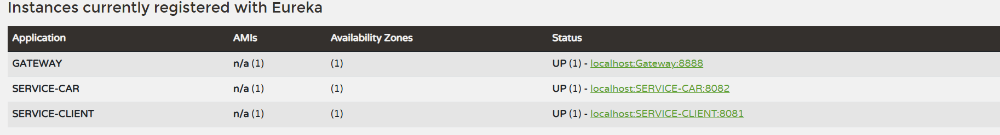
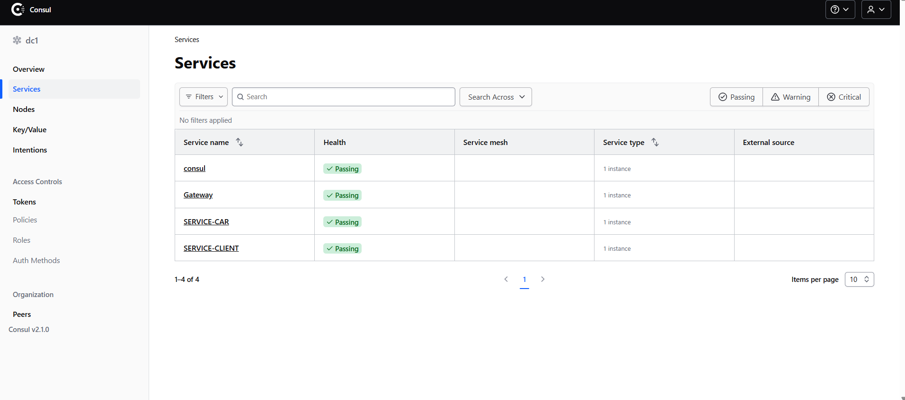

# TP : Migration Eureka → Consul

## Objectif

Remplacer Eureka par Consul pour l'enregistrement et la découverte des microservices Client, Car et Gateway.

## Image 1 : Eureka (avant migration)

Le tableau de bord Eureka montre les trois microservices (GATEWAY, SERVICE-CAR, SERVICE-CLIENT) enregistrés avec le statut **UP**. La découverte des services est assurée par Eureka.

## Image 2 : Consul (après migration)

L'interface Consul affiche les services consul, Gateway, SERVICE-CAR et SERVICE-CLIENT, tous avec l'état **Passing**. Les services sont désormais enregistrés et découverts via Consul.